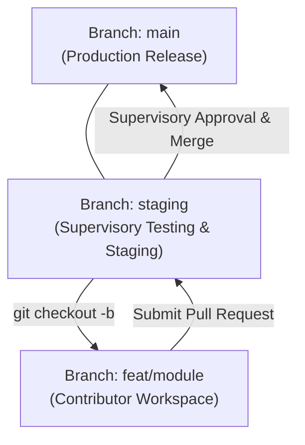

# PiGO Framework - Enterprise AI & Multi-Tier Collaboration

**Palalloi Integrate Gravity Orchestra (v13.4 Enterprise + PIOM DSOM-009 Aligned)** | Production AI Agent Governance & Team Engineering Ecosystem

---

## Apa itu PiGO Framework?

PiGO Framework adalah sistem pedoman arsitektur, tata kelola model kerja otonom AI (`AGENTS.md`), dan standar kolaborasi rekayasa perangkat lunak yang berfungsi sebagai **sistem saraf dan batasan integritas** bagi pengembang lintas peran (**Project Leads, System Supervisors, Module Contributors**) serta agen AI (Google Antigravity, Gemini, Claude, OpenRouter).

PiGO beroperasi sebagai **NEXUS Execution Adapter** di bawah model tata kelola kanonik **PIOM (Palalloi Integrated Operating Model)** dan metodologi **SDCM v0.9 (Core Freeze)**.

### 🏛️ Pemisahan 4 Entitas Tata Kelola (Ontology Separation):
1. **PIOM**: Model tata kelola, registri keputusan, dan matriks kebijakan (*Policy & Decision Registry*).
2. **SDCM**: Metode rekayasa perangkat lunak terkendali (*Controlled Software Development Method*).
3. **NEXUS / PiGO**: Sistem eksekusi dan orkestrasi teknis agen AI (*Autonomous Execution Adapter*).
4. **PIOM-ESAR / APF**: Publikasi riset akademik dan evaluasi empiris independen.

---

## Keselarasan PIOM DSOM-009 (November 2026)

PiGO Framework v13.4 menyelaraskan 4 pilar tata kelola terbaru dari review kanonik **PIOM DSOM-009**:

1. **Pembedaan Mutlak `GATE_CHECK: PASS` vs `OWNER GO`**:
   - Lolosnya pengujian mesin deterministik (`pigo test`, linter sintaks `php -l`, atau GitHub Actions CI) HANYA berstatus `GATE_CHECK: PASS`.
   - Hal tersebut **DILARANG** diartikan sebagai `OWNER GO`. Otoritas merger ke branch `main` atau deployment produksi mutlak membutuhkan persetujuan manusia dari **Principal Architect / Project Owner**.
2. **Efisiensi Sesi (Session Economy)**:
   - `EVIDENCE_SESSION`: Terdapat artefak bukti primer baru / perubahan kode substantif.
   - `MAINTENANCE_SESSION`: Sesi pemeriksaan status / sinkronisasi memori. **DILARANG membuat ZIP rilis baru** untuk mencegah inflasi artefak.
   - `DESIGN_CHANGE_SESSION`: Modifikasi kebijakan desain; tidak boleh menganggap temuan operasional selesai sepihak.
3. **Data Pendidikan Berisiko Tinggi (*High-Stakes Educational Gate*)**:
   - Perubahan logika, formula, atau mutasi data yang berdampak pada penilaian mahasiswa, instrumen asesmen, atau luaran akreditasi wajib melalui *Human Approval Gate*.
4. **Penanganan Tugas Macet (*Stalled Task Handling*)**:
   - Tugas yang tidak bergerak selama $\ge 2$ sesi atau $\ge 7$ hari diberi flag `stalled=true` dan dieskalasi ke antrean keputusan manusia (*Human Action Queue*), bukan di-bypass atau di-close sepihak.

---

## Ekosistem Kolaborasi & Tata Kelola Tim (Team Governance)

Repositori ini menerapkan tata kelola kolaborasi modern berstandar enterprise yang diuraikan lengkap pada [**COLLABORATION_GUIDE.md**](COLLABORATION_GUIDE.md):

### 1. Matriks Peran Profesional (Role Matrix)
- **Principal Architect & Project Lead** *(Supervisory Authority)*: Pemegang kewenangan penuh atas branch `main`, pengesah rilis produksi, penanggung jawab keamanan, dan pengelola rahasia environment.
- **System Supervisor & Core Reviewer** *(Review Authority)*: Pengawas kesesuaian arsitektur, reviewer kode tingkat pertama, pembimbing teknis modul, dan penilai kualitas Pull Request.
- **Module Contributor & Feature Developer** *(Implementation Team)*: Pengembang fitur mandiri pada branch terisolasi, pelaksana pengujian lokal, dan inisiator Pull Request terstandar.

### 2. Standar Alur Kerja 5 Tahap (5-Stage Pipeline)

### 3. Otomasi Template GitHub & CI/CD
- **Pull Request Template (`.github/PULL_REQUEST_TEMPLATE.md`)**: Checklist kepatuhan wajib bagi Contributor (validasi lokal, Anti-IDOR, Zero-Leakage, target ke branch `staging`).
- **Issue Task Template (`.github/ISSUE_TEMPLATE/task-template.md`)**: Penugasan modul terstruktur dari Supervisor kepada Contributor dengan rincian spesifikasi teknis dan target milestone.
- **GitHub Actions CI Workflow (`.github/workflows/ci.yml`)**: Otomasi pengujian sintaks seluruh berkas PHP (`php -l`) dan pemindaian kebocoran kredensial rahasia (*Gitleaks*).
- **Code Ownership (`.github/CODEOWNERS`)**: Menetapkan peninjau wajib otomatis pada berkas-berkas arsitektur inti dan migrasi database.

---

## Fitur Pertahanan Enterprise v13.4

### 1. Pertahanan Aplikasi Menyeluruh (Defense-in-Depth)
- **Validasi Skema Sisi Server (Server-Side Schema Validation)**: Validasi tipe data, batas panjang, dan regex di controller sebelum menyentuh database.
- **Proteksi CSRF Wajib**: Setiap request mutasi data (`POST`/`PUT`/`DELETE`) wajib memvalidasi token CSRF acak berbasis sesi selain cookie `SameSite=Strict`.
- **Role-Aware Anti-IDOR**: Kueri manipulasi data terikat kepemilikan pengguna: `WHERE id = :id AND (user_id = :current_user OR :role = 'admin')`.
- **HTTP Security Headers Lengkap**: CSP, X-Frame-Options, X-Content-Type-Options, Referrer-Policy, dan Permissions-Policy pada `.htaccess`.
- **Parser `.env` Kebal Error**: Fungsi pemuat environment yang aman dari baris kosong/cacat serta sinkron dengan `getenv()`, `$_ENV`, dan `$_SERVER`.

### 2. Pemindaian Otomatis Anti-Kebocoran (Automated Secret Scanner)
- Pemindaian regex berlapis (`api_key`, `secret`, `password`, `define()`, `mysql://`) dan validasi pipeline CI Gitleaks di GitHub.
- Commit otomatis dibatalkan jika ditemukan kredensial mentah di dalam kode sumber.

### 3. Manajemen File Lock Subagen (`.lock`) & Registry Tugas
- Penanda file `.lock` sementara (auto-timeout 5 menit) untuk mencegah tabrakan edit (*race condition*) antar subagen paralel tanpa dependensi Redis.
- Dokumen registry tugas resmi di `.agents/task.md` dan memori kerja di `.agents/working.md`.

---

## Riwayat Evolusi

| Versi | Highlight Utama | Catatan Audit |
|---|---|---|
| v1.0 - v2.0 | Fondasi Batasan & Security Hardening | Perlindungan OWASP Top 10 |
| v6.0 - v7.0 | Clean MVC & Anti-Bypass Checklist | Standarisasi validasi & sintaks |
| v8.0 - v10.0 | Autonomous Goal-Pursuing & Zero-Friction | Eksekusi otonom terpandu & Branding PiGO |
| v11.0 - v12.0 | Antigravity 2.0 & Dual-Tier Token Budgeting | Workhorse Tier 1 (Flash) + Frontier Tier 2 |
| v13.0 | Resilience Engine (RRE) & Stack Adaptation | Audit awal via Claude Haiku 4.5 |
| v13.1 | Session Continuity & File-Based Concurrency | Konsensus Multi-Agent (Gemini, Haiku, Opus) |
| v13.2 | Production Security Hardening & Zero-Leakage | Anti-IDOR, Rate-Limiting, Idempotency |
| v13.3 | Enterprise Production Grade & Governance | Role Matrix (Lead, Supervisor, Contributor), PR/Issue Template |
| **v13.4** | **PIOM DSOM-009 & CI-Ready Edition** | **Keselarasan PIOM-SDCM v0.9 Baseline A, Pemisahan Gate Pass vs Owner GO, Session Economy, dan High-Stakes Gate** |

---

## Pintasan Perintah PiGO (PiGO Shortcuts)

| Perintah | Deskripsi Tindakan Agen |
|---|---|
| `pigo run` | Jalankan instruksi dengan kepatuhan penuh framework v13.4 |
| `pigo fix` | Analisis error log, perbaiki kode, dan uji sintaks otonom |
| `pigo test` | Lakukan validasi sintaks dan cek anti-regresi pada berkas yang disentuh |
| `pigo sync` | Perbarui status checklist `.agents/working.md` dan `.agents/task.md` |
| `pigo audit` | Jalankan checklist Anti-Bypass, Pre-Commit Secret Scan, dan Anti-IDOR |
| `pigo pack` | Bersihkan artefak dan kemas rilis live production (`build_upload.ps1`) |

---

## Verifikasi Integritas Arsip Rilis

| Rilis | Berkas Arsip | Hash SHA256 |
|---|---|---|
| **v13.4** | `model_kerja_v13.4_production_ci_ready.zip` | `4897033A1EDA97B90DDE80AE436FF09CABC9B0C086810FCF3D3FBF105B2FD030` |
| v13.3 + Collab | `model_kerja_v13.3_enterprise_collaboration.zip` | `9EAE679AA078A6ECDD253EC986BEBB61CA4DBB0471A14392D89633069FE09A6F` |
| v13.3 | `model_kerja_v13.3_enterprise_production.zip` | `580DE45132DFBDA305FF7F4E665BEE4A3F9029397715D3BDC848DDD31C497B98` |

---
*Dikelola dan dikembangkan oleh [@ipalalloi](https://github.com/ipalalloi)*
