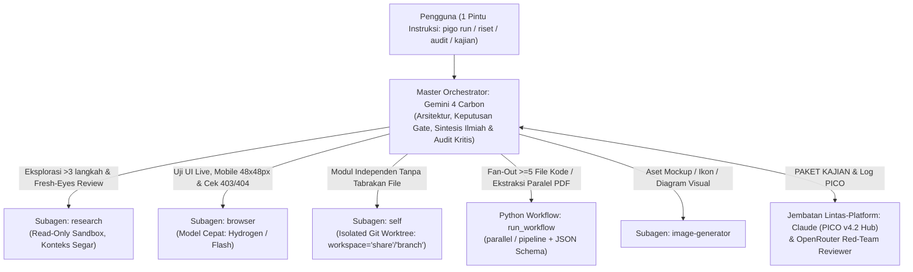

# PiGO Framework — Multi-Agent AI Orchestration, Security & Research Governance

**Palalloi Integrate Gravity Orchestra (v14.1 Enterprise — Berlaku Efektif: 25 November 2026)** | Gemini 4 Carbon Multi-Agent Orchestrator · Server-Agnostic & UU PDP Security · PIOM-SDCM v0.9 · PICO v4.2 Bridge · PRF v1.0 Academic Engine

[](https://github.com/ipalalloi/model-kerja-ai)
[]()
[]()
[](AGENTS.md)
[](.github/workflows/ci.yml)

---

## Apa itu PiGO Framework v14.1?

PiGO Framework v14.1 adalah sistem pedoman arsitektur, orkestrasi multi-agen otomatis, standar keamanan aplikasi lintas-server, serta mesin tata kelola riset ilmiah yang berjalan di **Google Antigravity (v2.35+)** dengan lini model **Gemini 4 Element Series (`Carbon`, `Argon`, `Neon`, `Hydrogen`)** dan jembatan kolaborasi lintas-platform **Claude (`PICO v4.2`)** serta **Palalloi Research Flow (`PRF v1.0`)**.

### Pembaruan Utama v14.1 (25 November 2026):
1. **Orkestrasi Komando Multi-Agen Otomatis (*Gemini 4 Carbon Orchestrator*)**:
   - Menetapkan **`Gemini 4 Carbon`** sebagai *Master Orchestrator* di Antigravity yang secara otomatis mendelegasikan tugas ke subagen spesialis (`research`, `browser` dengan model cepat *Hydrogen/Flash*, `self` dengan isolasi *git worktree* `workspace: "share"`, skrip paralel `run_workflow`, serta `openrouter_chat` Red-Team) tanpa pengguna harus memilih agen secara manual.
2. **Keamanan Produksi Lintas-Server (Apache + Nginx) & Kepatuhan UU No. 27/2022 PDP**:
   - Diangkat dari evaluasi produksi nyata (`SIMPEL-C` & `TAS_PWA`): menambahkan **`nginx.conf.example`** pendamping `.htaccess` (karena Nginx tidak membaca `.htaccess`), mewajibkan *Gated Document Streaming* (`berkas.php`) untuk dokumen warga/pribadi, penyamaran NIK/PII di halaman publik, keamanan *Service Worker* PWA, serta **Larangan Klaim Semu (*Claim–Code Parity*)** seperti mencetak label BSrE/enkripsi sebelum integrasinya aktif.
3. **Mesin Riset Ilmiah Terpadu: PRF v1.0 + 11 Jenis Literature Review**:
   - Mengadopsi penuh **11 Jenis Literature Review** beserta kerangka pertanyaan (**PICO/PICOS, PCC, SPIDER**) dan standar pelaporan internasional (**PRISMA 2020, PRISMA-ScR, PRIOR, ENTREQ, SANRA, JBI MMSR, Barry SotA, Thomas & Harden**) di [`skills/pico/references/riset-dan-literatur.md`](skills/pico/references/riset-dan-literatur.md).
4. **Pembersihan Artefak Usang & Konstitusi Ramping (< 8 KB)**:
   - Menjaga konstitusi inti tetap ringan untuk kuota 20.000 token Antigravity (*Progressive Disclosure*), merapikan berkas `.cursorrules` lama, dan memindahkan arsip versi historis ke folder `arsip_versi_lama/`.

---

## Arsitektur Komando & Delegasi Otomatis Multi-Agen

Pengguna cukup memberi instruksi di **satu jendela chat utama**; *Master Orchestrator* membagi tugas secara otomatis:



| Agen / Mode | Mesin Model | Peran Spesifik | Pemicu |
|---|---|---|---|
| **Main Orchestrator** | `Gemini 4 Carbon` *(Argon/Neon)* | Pengatur utama, perancang arsitektur, penyusun sintesis riset, & penentu kelulusan Gerbang Verifikasi. | Otomatis (Selalu Aktif) |
| **Subagen `research`** | `inherit` / `flash` | Penelusuran kode lintas-modul & *Goldfish Fresh-Eyes Review* (audit diff/sitasi tanpa bias riwayat chat). | Otomatis oleh Orchestrator |
| **Subagen `browser`** | `flash` *(Hydrogen)* | Pengujian form UI live, responsivitas PWA, dan verifikasi blokir `.env`/`uploads/` (403/404). | Otomatis saat menyentuh UI/Web |
| **Subagen `self` (`share`)** | `pro` / `flash` | Eksekusi fitur modular di worktree terisolasi tanpa saling menimpa berkas. | Otomatis pada subtugas paralel |
| **`run_workflow` (Python)** | `flash_lite` / `flash` / `pro` | *Fan-out* audit terprogram banyak berkas atau ekstraksi matriks bukti dari banyak PDF literatur sekaligus. | Otomatis untuk target $\ge 5$ item |
| **`/swarm` & `/teamwork`** | Multi-Worker + Verifier | Kolaborasi tim agen skala besar dengan *Adversarial Verifier* di papan pesan bersama. | Diketik pengguna (`/swarm`) |
| **PICO Bridge & Red-Team** | Claude Opus/Sonnet · DeepSeek | Kajian silang (`PAKET KAJIAN`), *Red-Team Review* disertasi/artikel, & sinkronisasi *PICO Monitor*. | `pigo kajian` / berkas Paket Kajian |

---

## Matriks 11 Jenis Literature Review (`pigo riset`)

Tersedia lengkap di [`skills/pico/references/riset-dan-literatur.md`](skills/pico/references/riset-dan-literatur.md) dan terintegrasi dengan **PRF v1.0** (*Zotero first*, *Scite smart citation check*, *Claim–Evidence Matrix*, & wajib mencatat bukti bertentangan):

| No | Jenis Literature Review | Kecocokan Riset | Kerangka & Standar Pelaporan |
|:--:|---|---|---|
| **01** | **Narrative Review** | Latar belakang bab & pemahaman luas lintas konsep | Tema Konseptual · **SANRA** |
| **02** | **Systematic Review** | Pertanyaan riset terfokus & sintesis efektivitas | **PICO / PICOS** · **PRISMA 2020** · RoB 2 / JBI |
| **03** | **Scoping Review** | Pemetaan bukti, konsep kunci, & *research gap* bidang baru | **PCC** · **PRISMA-ScR** · JBI Scoping |
| **04** | **Integrative Review** | Menggabungkan studi empiris + teoretis untuk kerangka baru | Konstruk Teori · **Whittemore & Knafl (2005)** |
| **05** | **Critical Review** | Mengevaluasi asumsi & keterbatasan guna memajukan teori | Kritik Klaim · **Grant & Booth SALSA** |
| **06** | **Rapid Review** | Bukti cepat terukur untuk keputusan kebijakan mendesak | **PICO** Terbatas · **Cochrane RR / PRISMA-RR** |
| **07** | **Umbrella Review** | Membandingkan temuan antar-*Systematic Review* yang ada | **PICO** Tinjauan · **PRIOR** · AMSTAR 2 |
| **08** | **Qualitative Evidence Synthesis** | Menggabungkan pengalaman hidup, makna, & konteks sosial | **SPIDER** · **ENTREQ / eMERGe** · GRADE-CERQual |
| **09** | **Mixed Methods Review** | Integrasi dampak kuantitatif & pengalaman kualitatif | **PICO + SPIDER** · **JBI MMSR** · MMAT |
| **10** | **State-of-the-Art (SotA) Review** | Garda depan perkembangan terkini & arah masa depan | Kronologi Frontier · **Barry et al. (2022)** |
| **11** | **Thematic Review** | Pengelompokan tema berulang, pola, perbedaan, & celah | Matriks Konsep · **Thomas & Harden / Braun & Clarke** |

---

## Protokol Identitas Wajib (Header & Footer Stamp)

**Pembuka Respons (Baris Pertama):**
> 🛡️ **PiGO Framework v14.1** *(Berlaku: 25 November 2026)* | **Governance:** PIOM-SDCM v0.9 · PICO v4.2 · PRF v1.0

**Penutup Respons (Baris Terakhir):**
```markdown
---
⚡ **PiGO v14.1 Active** *(Eff: 25 Nov 2026)* · **Verifikasi:** `<Lolos / Sebagian / Belum / N/A>` · **Wadah:** `<Nama Proyek / Global>` · **Status:** `<Selesai / In-Progress / Menunggu Keputusan>`
```

---

## Pintasan Perintah PiGO (PiGO Shortcuts v14.1)

| Perintah | Deskripsi Tindakan Otonom Agen |
|---|---|
| `pigo run [tugas]` | Lanjutkan tugas aktif di `.agents/task.md` atau eksekusi fitur baru (*Smallest Complete Change* + *Anti-Slop*) |
| `pigo fix [isu]` | Diagnosis akar error, perbaiki tanpa merusak signature publik, dan uji ulang hingga gejala hilang |
| `pigo riset [jenis/topik]` | Jalankan telaah pustaka (01–11 Jenis Review), susun protokol PRISMA/PCC/SPIDER, & *Claim–Evidence Matrix* PRF |
| `pigo kajian [topik]` | Buat atau kerjakan **PAKET KAJIAN** lintas-model sesuai protokol PICO v4.2 + hasilkan baris `Log PICO` |
| `pigo test` | Jalankan Gerbang Verifikasi sintaks/unit CLI (`php -l`, `tsc --noEmit`, `pytest`) pada sesi aktif |
| `pigo preflight` | Cek kesiapan rilis produksi: nol password demo, bebas klaim semu, proteksi Apache+Nginx, & kepatuhan UU PDP |
| `pigo audit [target]` | Audit keamanan aplikasi (Zero-Leakage, Anti-IDOR, CSRF) atau audit skill pihak ketiga (`audit-skill.md`) |
| `pigo sync` | Sinkronkan memori `.agents/working.md` & `.agents/task.md` (*Maintenance Session* — tanpa buat ZIP baru) |
| `pigo pack` | Kemas paket rilis produksi bersih via `build_upload.ps1` (*Evidence Session*) + catat hash SHA256 otomatis |

---

## Riwayat Evolusi

| Versi | Highlight Utama | Tanggal Berlaku |
|---|---|---|
| v1.0 - v10.0 | Fondasi OWASP, Clean MVC, Autonomous Goal-Pursuing & Zero-Friction PiGO | Jul - Sep 2026 |
| v11.0 - v13.3 | Dual-Tier Token, Resilience Engine, Session Continuity & Multi-Tier Collaboration | Okt 2026 |
| v13.4 | Fail-Closed CI (`ci.yml`, `CODEOWNERS`, `.env.example`, `task.md`) & PIOM DSOM-009 | 1 Nov 2026 |
| v14.0 | Unified PiGO x PICO v4.2 Bridge, Header/Footer Stamp Wajib & Progressive Disclosure | 20 Nov 2026 |
| **v14.1** | **Gemini 4 Carbon Multi-Agent Orchestration, Apache+Nginx & UU PDP Hardening, Claim–Code Parity, serta PRF v1.0 + 11 Literature Reviews Engine** | **25 Nov 2026** |

---

## Verifikasi Integritas Arsip Rilis

| Rilis | Berkas Arsip | Hash SHA256 |
|---|---|---|
| **v14.1** | `model_kerja_v14.1_carbon_orchestrator_prf.zip` | `6433AB47AD6E6D385A28B3B5B7180182FB7CB28B896D84B73093DFC341B649D9` |
| v14.0 | `model_kerja_v14.0_unified_pigo_pico.zip` | `EEA15459416920BD353BDDFFC60E0499D63EDF99379F4B24F13A4364175C0183` |
| v13.4 | `model_kerja_v13.4_production_ci_ready.zip` | `4897033A1EDA97B90DDE80AE436FF09CABC9B0C086810FCF3D3FBF105B2FD030` |

---
*Dikelola dan dikembangkan oleh [@ipalalloi](https://github.com/ipalalloi)*
